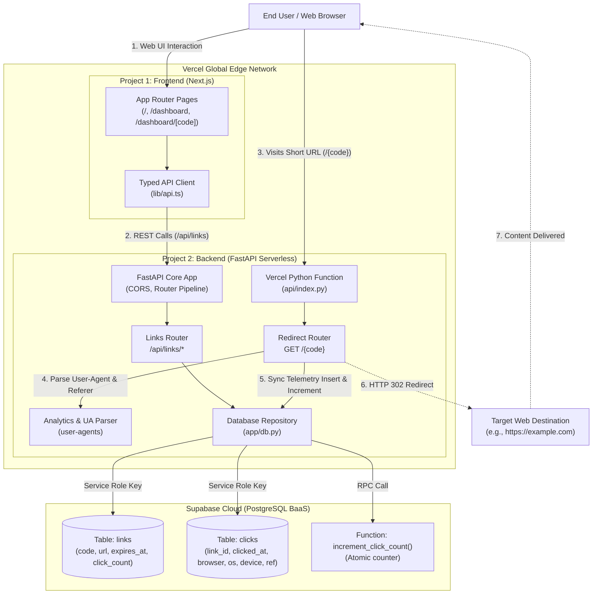

# LinkPulse Architecture & System Design

This document details the architectural layout, component interactions, and data flow of **LinkPulse**, a serverless URL shortener and click analytics engine built for cloud-native deployment.

---

## 1. System Topology (Mermaid Diagram)

---

## 2. Core Architectural Components

### A. Next.js Frontend (Vercel Project 1)
- **Framework**: Next.js 15/16 App Router with React 19, TypeScript, and Tailwind CSS.
- **Client Components**: Interactive forms for link generation, responsive tables for link lifecycle management, and interactive charts via Recharts.
- **Security Boundary**: The frontend communicates strictly with the backend API via `NEXT_PUBLIC_API_BASE_URL`. **It holds zero Supabase keys and has no direct database access.**

### B. FastAPI Serverless Backend (Vercel Project 2)
- **Runtime**: Python 3.12 running inside Vercel's serverless function runtime (`api/index.py`).
- **Framework**: FastAPI and Pydantic v2 for strict request validation and automatic OpenAPI documentation generation.
- **Synchronous Telemetry**: When a user accesses `/{code}`, the backend parses the HTTP `User-Agent` and `Referer` headers, inserts the click record into Supabase, increments the counter atomically via a PostgreSQL stored procedure, and returns an **HTTP 302** redirect.
- **Why Synchronous Logging**: In serverless architectures (like AWS Lambda or Vercel Functions), function execution is frozen immediately upon returning an HTTP response. Background tasks or asynchronous threads risk premature termination, leading to dropped telemetry events. Synchronous logging guarantees zero telemetry loss.
- **Why HTTP 302 (Not 301)**: HTTP 301 is a permanent redirect that browsers aggressively cache locally. Future visits would bypass the serverless backend completely, failing to record clicks. HTTP 302 guarantees that every link visit hits the backend.

### C. Supabase Managed Database (Backend-as-a-Service)
- **Engine**: Managed PostgreSQL with connection pooling.
- **Row Level Security (RLS)**: Enabled on all tables (`links`, `clicks`). With no public policies defined, client-side or anon access is forbidden. Only the backend using the privileged `SUPABASE_SERVICE_ROLE_KEY` can read and write data.
- **Indexes**: Composite index on `(link_id, clicked_at)` allows instant sub-millisecond retrieval of time-series click logs for the 14-day zero-filled analytics chart.
- **Foreign Key Cascades**: Deleting a link automatically purges all corresponding click rows via `on delete cascade`.

---

## 3. Request-Response Lifecycles

### 1. Link Creation (`POST /api/links`)
1. User submits target URL, optional custom alias, and optional expiry hours.
2. Backend validates that the URL scheme is `http` or `https`, length $\le 2048$, and does not self-reference LinkPulse hosts (preventing redirect loops).
3. If alias is provided, backend checks against reserved system routes (`api`, `docs`, `health`, `dashboard`, `admin`, `static`, `_next`, `favicon.ico`, `robots.txt`).
4. If no alias is provided, generates a 6-character Base62 string with cryptographic `secrets`. Retries up to 5 times on unique constraint collision.
5. Record is inserted into Supabase `links` table. Returns HTTP 201 with full short URL.

### 2. Redirection & Click Tracking (`GET /{code}`)
1. Client requests short link (e.g., `https://linkpulse.vercel.app/my-code`).
2. Backend queries `links` table by code.
3. If not found $\rightarrow$ HTTP 404.
4. If expired ($expires\_at \le now()$) $\rightarrow$ HTTP 410 Gone.
5. User-Agent is parsed into browser family, OS family, and device classification (`Mobile`, `Tablet`, `PC`, `Bot`). Referer header is cleaned.
6. Click row is inserted into `clicks` and `click_count` is incremented.
7. Backend returns HTTP 302 with header `Location: <original_url>`.
